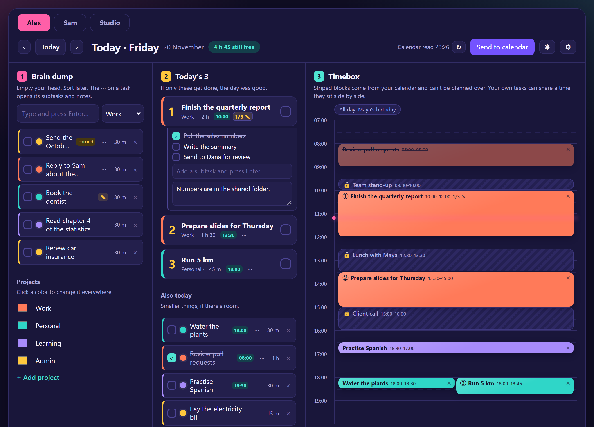
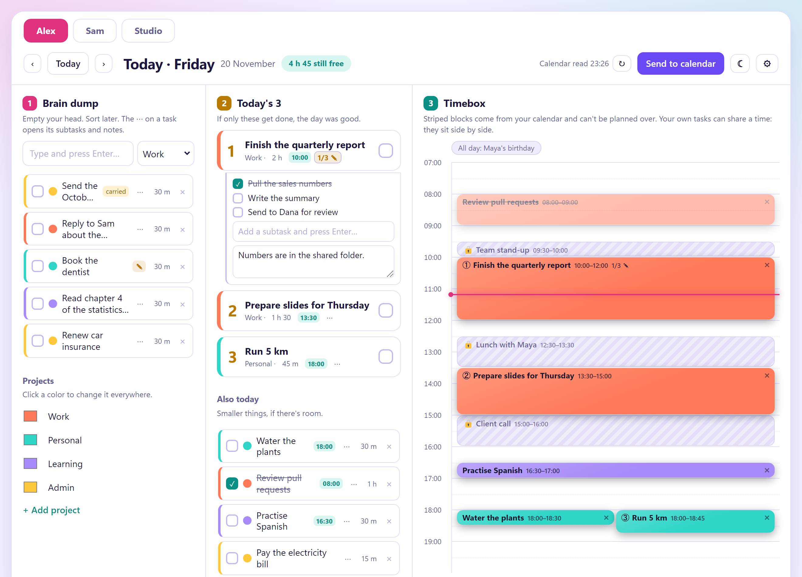
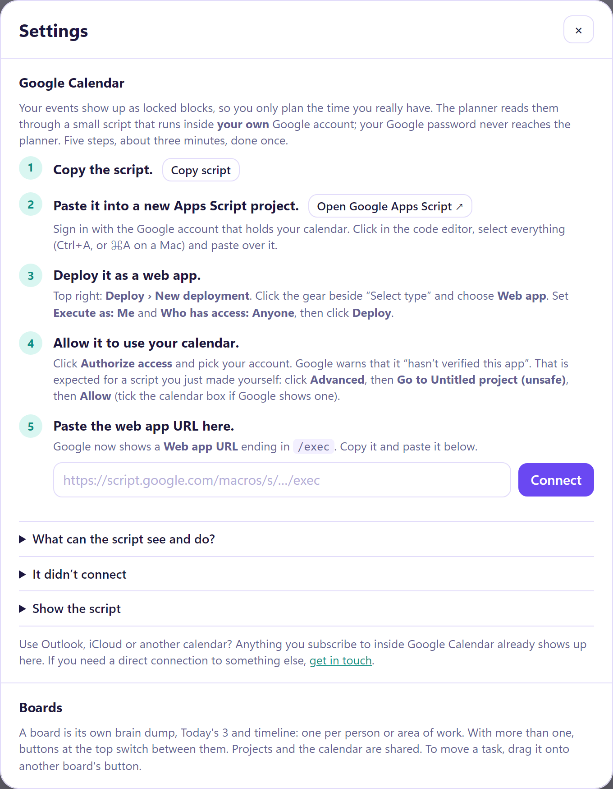

<h1 align="center">Planner</h1>

<p align="center">
  <b>Plan your day on one page: empty your head, pick three things that matter, fit them around your calendar.</b><br>
  Runs on your own computer. No account, no subscription, no tracking.
</p>

<p align="center">
  <a href="#run-it-on-your-computer"><b>Run it</b></a> ·
  <a href="#connect-google-calendar">Connect Google Calendar</a> ·
  <a href="docs/hosting.md">Host it online</a> ·
  <a href="https://tonihaddad.github.io/planner/">Website</a>
</p>

<p align="center">
  
</p>
<p align="center"><sub>Dark is the standard look. The sun button in the top bar switches to light:</sub></p>
<p align="center">
  
</p>

## How it works

You plan a day in three moves, left to right:

1. **Brain dump.** Type everything on your mind and press Enter. Don't sort yet.
2. **Today's 3.** Drag the three tasks that matter most into the numbered slots. Smaller ones go to "Also today".
3. **Timebox.** Drag tasks onto the timeline. Events from your calendar are striped, locked blocks, so you can only plan the time you really have.

What you don't finish goes back to the brain dump the next day, marked "carried", so nothing is lost and nothing piles up on a date that has passed.

## What you get

- **One page, no setup.** Start it and the board is there. No sign-up and no sign-in on your own computer.
- **Your real day.** Google Calendar events appear on the timeline and can't be planned over. The header shows how much time is still free.
- **Time blocks back to your calendar.** One button writes the day's blocks to a separate Google calendar named "Planner". Run it again and it replaces them, never duplicates.
- **Projects in color.** Give each project a color; blocks and dots take it everywhere.
- **Drag and drop, 15-minute snap, resize from the bottom edge, undo on delete.**
- **Subtasks and notes.** The ⋯ on a task opens a checklist and a notes box under it.
- **Boards.** Keep separate lists for separate people or areas of work, with buttons at the top to switch. Drag a task onto a button to move it.
- **Two things at once.** Tasks can share a time on the timeline; they sit side by side.
- **Dark and vivid**, with a light look one click away.
- **Yours.** Tasks live in one SQLite file on your machine. The app is plain PHP and plain JavaScript: no frameworks, no build step, nothing to keep updated.

## Run it on your computer

You need [PHP](https://www.php.net/) 8.0 or newer. Nothing else.

### Windows

1. [Download the ZIP](https://github.com/ToniHaddad/planner/archive/refs/heads/main.zip) and unzip it anywhere (or `git clone` this repository).
2. Double-click **`start.bat`**.

If PHP is missing, `start.bat` offers to install it for you (through `winget`, which comes with Windows 10 and 11). Then double-click it again.

### macOS

```sh
brew install php        # once
git clone https://github.com/ToniHaddad/planner.git
cd planner && ./start.sh
```

### Linux

```sh
sudo apt install php-cli php-sqlite3 php-curl php-mbstring   # once (Debian, Ubuntu)
git clone https://github.com/ToniHaddad/planner.git
cd planner && ./start.sh
```

The planner opens in your browser. Keep the terminal window open while you use it, and press Ctrl+C there to stop. Next time, start it the same way.

Good to know:

- **Where your tasks are:** `public/data/planner.sqlite`. Back up the `public/data` folder and you have backed up everything.
- **Who can reach it:** only you, on this computer. The planner refuses anything that does not come from the machine it runs on, and anything that was not opened through the start file (which hands your browser a private key).
- **Updating:** download the new version over the old one (or `git pull`). `public/data` is never touched.
- **Another port:** `php start.php --port 9000`.

## Connect Google Calendar

Optional, about three minutes, done once. In the planner, open **Settings (the gear, top right)** and follow the five numbered steps:

<p align="center">
  
</p>

In short: you copy a small script, paste it into your own Google account (Google Apps Script), deploy it, and give the planner the address Google shows you. The planner then reads every calendar you have ticked in Google Calendar, and never sees your Google password.

The full walkthrough, with what each Google screen looks like and what to do when something doesn't work, is in **[docs/google-calendar.md](docs/google-calendar.md)**.

### Outlook, iCloud and other calendars

Any calendar you have **subscribed to inside Google Calendar** already shows up in the planner, which covers most Outlook and iCloud setups.

If you need a direct connection to another calendar, or something else the planner doesn't do yet, **[contact me by opening an issue](https://github.com/ToniHaddad/planner/issues/new)** and tell me what you use. I'm happy to help.

## Using the board

| To do this | Do this |
|---|---|
| Add a task | Type in Brain dump, pick a project beside it, press Enter |
| Plan it | Drag it into Today's 3, Also today, or straight onto the timeline (snaps to 15 minutes) |
| Move or resize a block | Drag the block; pull its bottom edge; the × takes it off the timeline |
| Change project or length | Click the task's colored dot; click its minutes |
| Rename | Double-click the title |
| Finish | Tick the box |
| Delete | The × on the task. "Undo" appears for a few seconds and puts it back |
| Change days | The arrows and the Today button, top left. You can plan tomorrow in advance |
| Project colors | Bottom left: click a color to change it everywhere; rename, add or delete projects |
| Day hours | Settings: choose when your day starts and ends |
| Put the plan in your calendar | **Send to calendar** (appears once a calendar is connected) |

On a phone or tablet, press and hold a task for a moment, then drag it. Holding it near the top or bottom edge scrolls the page, so you can carry a task from the brain dump down to the timeline.

## Use it from several computers

The local version keeps its data on one machine. If you work on more than one, put the planner on a web host: the same app, behind a username and password, reachable from anywhere.

It needs only PHP and a folder, so the cheapest shared hosting plan is enough. Steps are in **[docs/hosting.md](docs/hosting.md)**.

## Privacy

- No analytics, no third-party scripts, no fonts or files loaded from elsewhere.
- Your tasks stay in `public/data` on the machine that runs the planner.
- The calendar connection goes from the planner to a script in **your** Google account. No one else's server is involved, and you can switch the script off in Google at any time.

## For developers

```
public/           the whole app: this folder is the web root
  index.php       the page (board, or sign-in when hosted)
  api.php         JSON API
  assets/         app.js, app.css: no dependencies, no build step
  lib/            boot.php (config, SQLite schema, sessions), calendar.php,
                  bridge.gs.txt (the Apps Script the user pastes into Google)
  data/           created at first run: config.php, planner.sqlite. Never in git
start.php         runs the planner locally (start.bat and start.sh call it)
tools/            router.php (local server rules), make-config.php (hosted setup),
                  deploy.py (Hostinger), screenshots.py
tests/            test_api.py, test_browser.py
docs/             guides and the website
```

Run the tests (they start a throwaway server and a fake calendar; no real data or Google account is touched):

```sh
python tests/test_api.py
pip install playwright && playwright install chromium   # once
python tests/test_browser.py
```

How the pieces fit, and the security model, are described in [CLAUDE.md](CLAUDE.md). Issues and pull requests are welcome.

The first version of this planner was a Google Sheets script. It is kept in [`Planner.gs`](Planner.gs), with its instructions in [docs/sheets-version.md](docs/sheets-version.md).

## License

[MIT](LICENSE). Use it, change it, host it.
